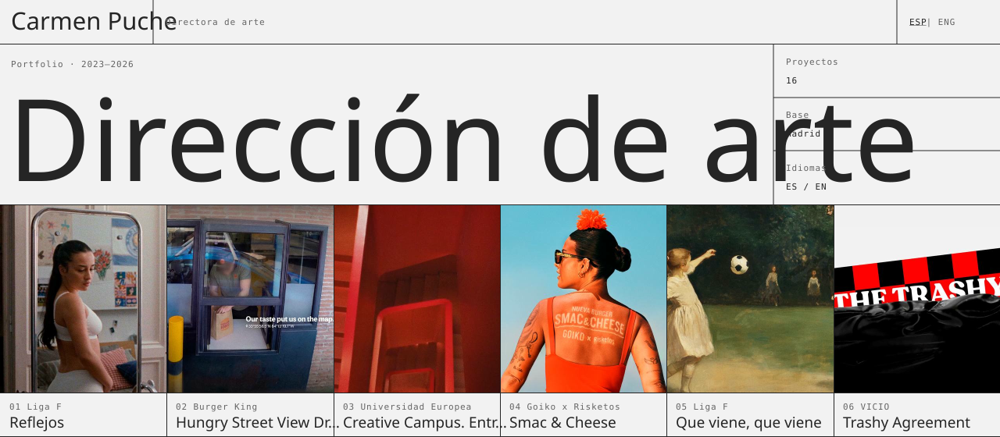
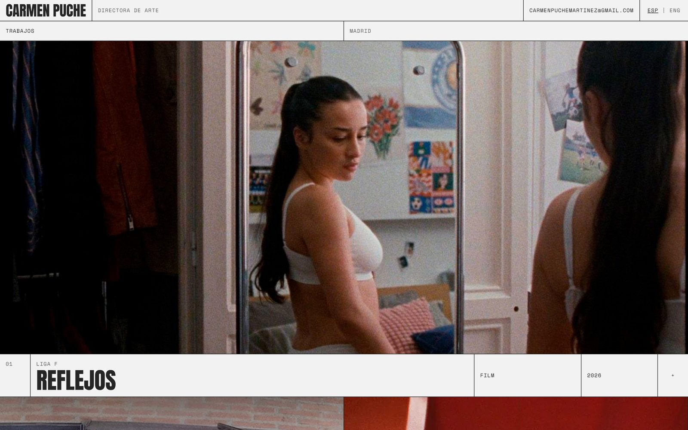
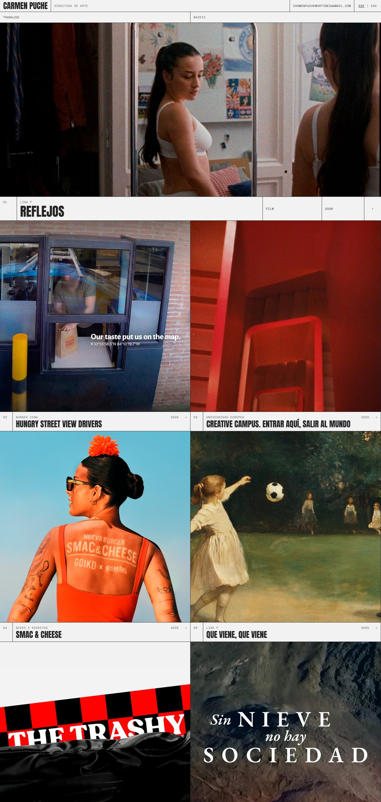
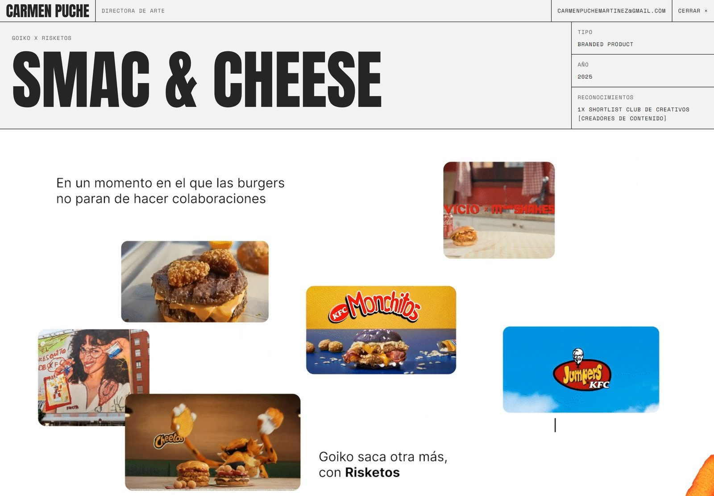
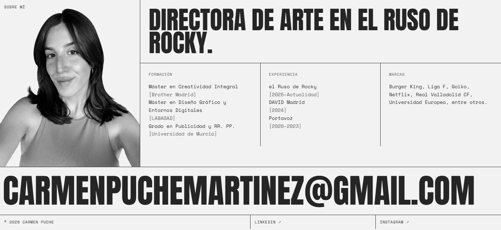
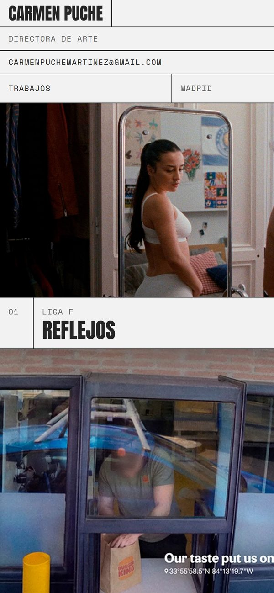
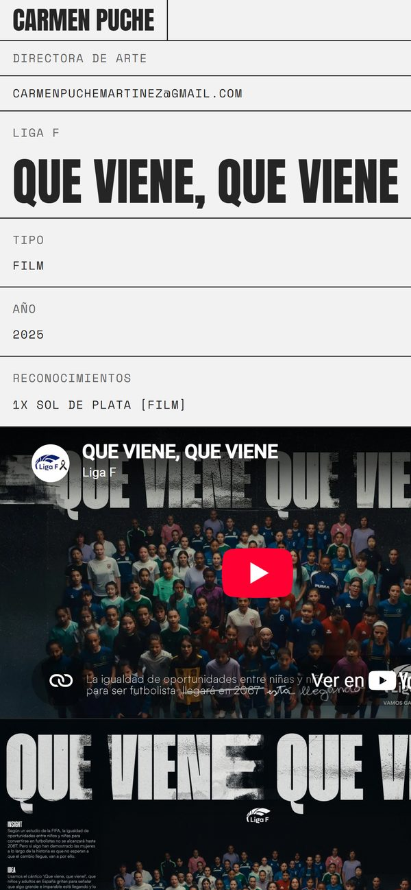
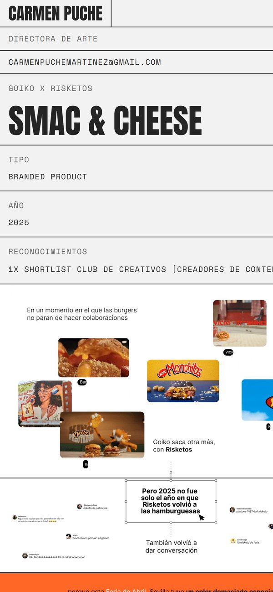

<div align="center">



<br>


**16 proyectos · español e inglés · todo prerenderizado**<br>
el portfolio de Carmen Puche, directora de arte en Madrid: una retícula suiza donde mandan las piezas.

[**carmenpuche.com**](https://carmenpuche.com)

[cómo se recorre](#cómo-se-recorre) ·
[añadir un proyecto](#añadir-un-proyecto) ·
[seo](#seo-y-enlaces) ·
[decisiones técnicas](#decisiones-técnicas) ·
[arrancarlo](#arrancarlo)

</div>

<br>



## La idea

Un portfolio de dirección de arte tiene un solo trabajo: que el trabajo se vea. Así que la
web es casi solo retícula: líneas de 1 px, una tipografía condensada para los títulos
(**Anton**), una monoespaciada para todo lo demás (**Space Mono**) y dos grises. El color
lo ponen las campañas.

Nada de animaciones de entrada, carruseles ni loaders: abres la web y ya estás viendo
el último film.

## Cómo se recorre

<table>
<tr>
<td width="50%" valign="top">



</td>
<td width="50%" valign="top">

1. **Destacado.** El proyecto más reciente, a todo el ancho, con cliente, tipo y año en
   una fila de ficha.
2. **Mosaico.** Los seis siguientes, en cuadrados a dos columnas, numerados `02`…`07`.
3. **Archivo de escuela.** Los trabajos de 2023–2024 como una lista tipográfica. Al pasar
   el ratón por encima aparece su portada flotando junto al título.
4. **Sobre mí.** Retrato, formación, experiencia y marcas.
5. **Contacto.** El email a todo el ancho, que se invierte al pasar por encima.

Cada proyecto abre su propia página con el título gigante, una ficha (tipo, año y
reconocimientos) y sus piezas una debajo de otra: films de YouTube o Vimeo, vídeos en
bucle y gráficas. Al final, el enlace al **siguiente proyecto**.

</td>
</tr>
</table>





### En el móvil

<table>
<tr>
<td align="center" width="33%">
<br>
<sub>la cabecera se apila en filas</sub>
</td>
<td align="center" width="33%">
<br>
<sub>la ficha pasa debajo del título</sub>
</td>
<td align="center" width="33%">
<br>
<sub>las piezas, a todo el ancho</sub>
</td>
</tr>
</table>

## Añadir un proyecto

Todo el contenido vive en un solo archivo, [`src/data/projects.json`](src/data/projects.json).
El orden del array es el orden de la home: el primero es el destacado, los seis siguientes
forman el mosaico y el resto va al archivo.

```jsonc
{
  "id": "goiko-risketos",              // la URL: /projects/goiko-risketos
  "client": "Goiko x Risketos",
  "title": "Smac & Cheese",
  "year": "2025",
  "type": "Branded product",           // «Campaña», «Gráfica»… se traducen en /en
  "image": "/GOIKO/PORTADA.png",       // portada de la home y imagen para redes
  "awards": ["1x Shortlist Club de Creativos [Creadores de contenido]"],
  "media": [
    { "kind": "embed", "src": "https://player.vimeo.com/video/1168447664" },
    { "kind": "video", "src": "/GOIKO/1.mp4" },                    // en bucle y sin sonido
    { "kind": "video", "src": "/REFLEJOS/3.mp4", "controls": true }, // con controles
    { "kind": "image", "src": "/GOIKO/2.png" }
  ]
  // "mediaLayout": "triptych"         // opcional: las piezas en tres columnas
}
```

Los archivos van en `public/<PROYECTO>/`. Al hacer el build, la página del proyecto, su
entrada en el sitemap y sus metadatos se generan solos.

<table>
<tr>
<th width="33%">🎬 embed</th>
<th width="33%">🔁 video</th>
<th width="33%">🖼️ image</th>
</tr>
<tr valign="top">
<td>

Un `iframe` 16:9 con carga diferida. Los films de YouTube van por `youtube-nocookie.com`
para no dejar cookies hasta que alguien le da al play.

</td>
<td>

MP4 en bucle, sin sonido y con `playsInline`, como un GIF pero pesando una fracción.
Con `"controls": true` se convierte en un vídeo normal, con sonido.

</td>
<td>

Gráficas a todo el ancho. La primera se carga al momento; el resto, solo cuando te
acercas a ellas.

</td>
</tr>
</table>

## SEO y enlaces

- **Una página por idioma.** `/` en español y `/en` en inglés, cada una con su `canonical`
  y con `hreflang` apuntando a la otra. El selector `ESP | ENG` de la cabecera es un
  enlace de verdad, no un cambio de estado que los buscadores no ven.
- **Datos estructurados.** La home lleva un `Person` de schema.org (cargo, ciudad, agencia
  y redes) y cada proyecto un `CreativeWork` con cliente, año y premios.
- **Metadatos por proyecto.** Título, descripción y Open Graph salen del JSON, con la
  portada como imagen al compartir.
- **`sitemap.xml` y `robots.txt`** generados desde los mismos datos.
- **Las URLs antiguas siguen funcionando.** La primera versión de la web, en Astro, tenía
  rutas como `/vicio-trashy-agreement`. [`next.config.ts`](next.config.ts) las redirige con
  un **301** a `/projects/vicio`, así que los enlaces que ya circulaban no se rompen.

## Decisiones técnicas

| Decisión | Por qué |
|---|---|
| **Next.js con generación estática** | Todas las páginas se prerenderizan en el build con `generateStaticParams`. Es un portfolio: el contenido cambia cuando hay proyecto nuevo, no en cada visita. |
| **Un JSON en vez de un CMS** | Son 16 proyectos que se tocan unas pocas veces al año. Un archivo versionado en git es más simple que un panel, una base de datos y sus credenciales. |
| **MP4 en vez de GIF** | Los bucles de las campañas empezaron siendo GIF. En MP4, el mismo bucle pesa mucho menos, se ve mejor y no bloquea la carga de la página. |
| **Tailwind 4 con tokens propios** | Cinco colores en `:root` (fondo, texto, secundario, borde y apagado) y dos clases, `.display` y `.label`. Toda la web sale de ahí. |
| **Fuentes con `next/font`** | Anton y Space Mono se sirven desde el propio dominio, sin peticiones a Google al cargar la página y sin saltos de texto. |
| **Retícula con bordes, no con huecos** | Cada celda tiene su borde de 1 px, así que la cuadrícula se mantiene sola al pasar de una a dos columnas o al apilarse en el móvil. |

## Estructura

```
src/
  app/
    page.tsx               home en español: destacado, mosaico, archivo y sobre mí
    en/page.tsx            home en inglés, con sus propios metadatos
    projects/[id]/page.tsx página de proyecto, metadatos y JSON-LD
    layout.tsx             fuentes, metadatos globales y Open Graph
    sitemap.ts · robots.ts
    globals.css            tokens de color y las clases .display y .label
  components/
    SiteHeader.tsx         cabecera con el selector ESP | ENG
    ProjectView.tsx        ficha y piezas de un proyecto
  data/
    projects.json          todo el contenido
    projects.ts            tipos y traducción de los tipos de proyecto
public/                    portadas, imágenes y vídeos de cada proyecto
next.config.ts             redirecciones 301 de las URLs antiguas
docs/readme/               imágenes de este README y el script que las genera
```

## Arrancarlo

<details>
<summary><b>desarrollo local</b></summary>

Requisitos: Node.js 20 o superior.

```bash
npm install
npm run dev     # http://localhost:3000, con Turbopack
```

</details>

<details>
<summary><b>producción</b></summary>

```bash
npm run build   # prerenderiza la home, /en y las 16 páginas de proyecto
npm start
```

Las redirecciones de `next.config.ts` necesitan el servidor de Next (o un hosting que las
entienda, como Vercel o Netlify); con un `output: "export"` puramente estático se perderían.

</details>

<details>
<summary><b>regenerar las imágenes del README</b></summary>

Con la web sirviéndose en local:

```bash
npm run build && npm start
python docs/readme/generar.py   # requiere Pillow y Chrome o Edge
```

El script monta el hero SVG con Anton y Space Mono incrustadas y las seis primeras portadas
de `projects.json`, y hace las capturas con Chrome en modo headless. Con `--solo-hero` solo
regenera el SVG, y con `--url` apunta a otro puerto.

</details>

---

<div align="center">
<sub>dirección de arte: <b>Carmen Puche</b> · desarrollo: <a href="https://github.com/aadolfo8">Adolfo Clemente</a></sub>
</div>
